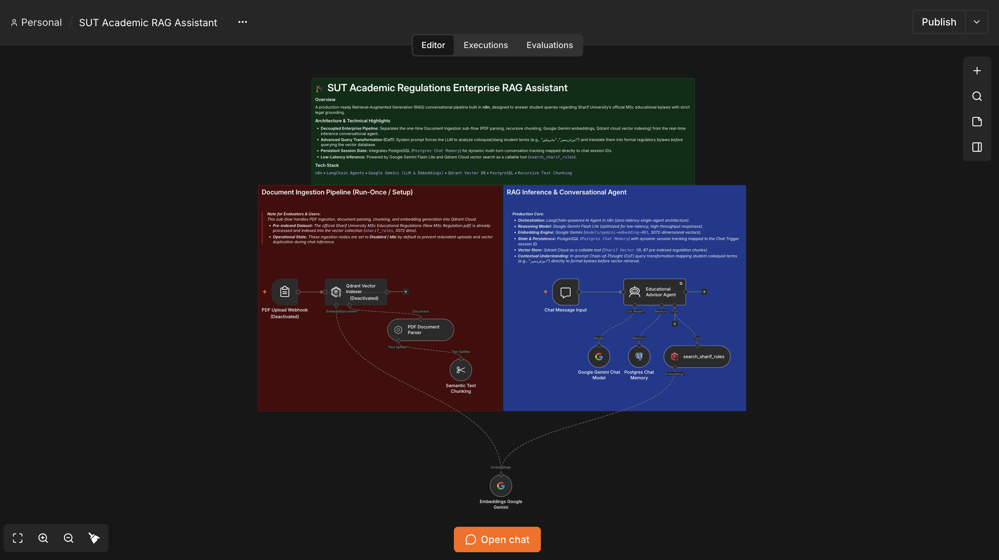

# 🎓 SUT Academic Regulations Enterprise RAG Assistant

A production-ready Retrieval-Augmented Generation (RAG) conversational pipeline built in **n8n**, designed to answer student queries regarding Sharif University's official MSc educational bylaws with strict legal grounding.

---

### 🏛️ Architecture & Technical Highlights
* **Decoupled Enterprise Pipeline:** Separates the one-time Document Ingestion sub-flow (PDF parsing, recursive chunking, Google Gemini embeddings, Qdrant cloud vector indexing) from the real-time inference conversational agent.
* **Advanced Query Transformation (CoT):** System prompt forces the LLM to analyze colloquial/slang student terms (e.g., "آموزش‌محور", "مشروطی") and translate them into formal regulatory bylaws *before* querying the vector database.
* **Persistent Session State:** Integrates PostgreSQL (`Postgres Chat Memory`) for dynamic multi-turn conversation tracking mapped directly to chat session IDs.
* **Low-Latency Inference:** Powered by Google Gemini Flash Lite and Qdrant Cloud vector search as a callable tool (`search_sharif_rules`).

---

### 🛠️ Tech Stack & Tools
* **Workflow Engine:** `n8n` (Self-Hosted via Docker)
* **Orchestration:** LangChain-powered AI Agents
* **LLM & Embeddings:** Google Gemini (`gemini-3.1-flash-lite`, `gemini-embedding-001`)
* **Vector Store:** Qdrant Cloud
* **Memory Layer:** PostgreSQL