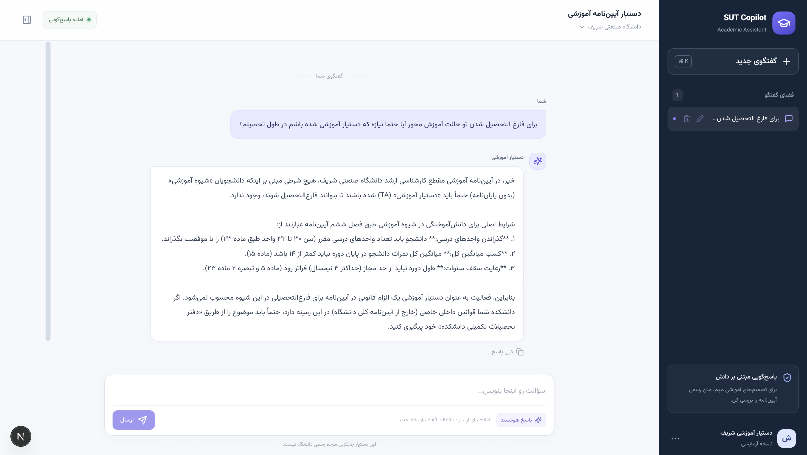
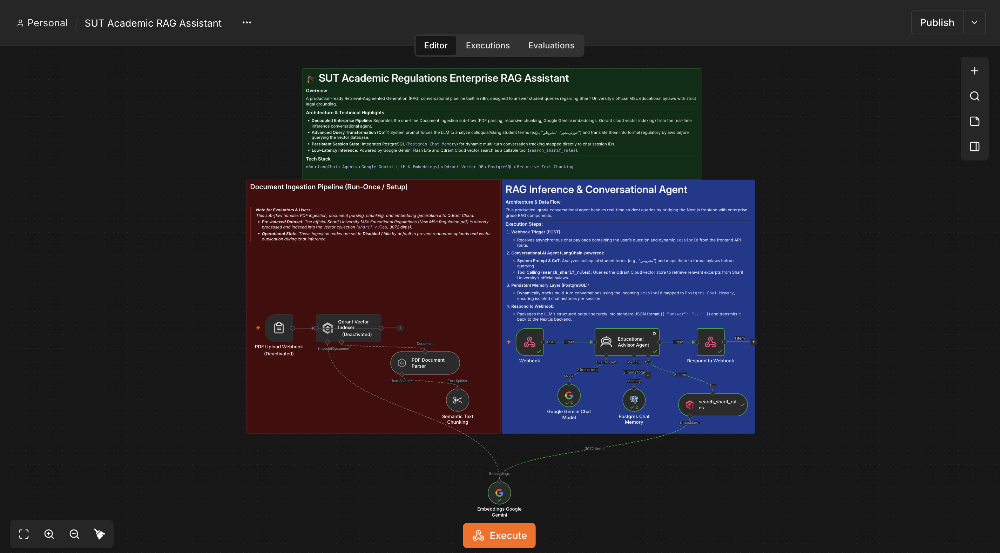

# 🎓 SUT Academic Regulations Enterprise RAG Assistant

A production-ready, full-stack conversational Retrieval-Augmented Generation (RAG) system built for Sharif University students, featuring a modern Next.js frontend and an n8n-powered backend.

## 📸 Preview

### 🎨 Frontend Interface

  

### ⚙️ n8n Automation Workflow

  

---

### 🏛️ Architecture & Technical Highlights
* **Full-Stack Decoupled Architecture:** Separates a high-performance Next.js (App Router) frontend interface from an advanced n8n RAG workflow via secure server-side API routes.
* **Advanced Conversational UI:** Implements a feature-rich SPA chat interface with persistent local storage, dynamic multi-session management, auto-titling, and interactive chat deletion/renaming.
* **Document Ingestion Pipeline:** Decoupled one-time sub-flow handling PDF parsing, recursive chunking, Google Gemini embeddings, and Qdrant Cloud vector indexing.
* **Advanced Query Transformation (CoT):** System prompt forces the LLM to analyze colloquial student terms (e.g., "مشروطی") and translate them into formal regulatory bylaws *before* vector search.
* **Persistent Session State:** Integrates PostgreSQL (`Postgres Chat Memory`) for dynamic multi-turn conversation tracking mapped directly to frontend session IDs.
* **Low-Latency Inference:** Powered by Google Gemini Flash Lite and Qdrant Cloud vector search as a callable tool (`search_sharif_rules`).

---

### 🛠️ Tech Stack & Tools
* **Frontend:** Next.js (App Router), TypeScript, Tailwind/Custom CSS, Lucide Icons
* **Workflow Engine & Backend:** `n8n` (Self-Hosted), Webhooks, REST APIs
* **Orchestration:** LangChain-powered AI Agents
* **LLM & Embeddings:** Google Gemini (`gemini-3.1-flash-lite`, `gemini-embedding-001`)
* **Vector Store:** Qdrant Cloud
* **Memory & Database:** PostgreSQL

---

 ## 🚀 Setup

**Prerequisites:** the root Docker stack is running (see the repository root README), Node.js 20.9+, a Google AI Studio API key, a Qdrant Cloud cluster (URL + API key).

1. Import `SUT Academic RAG Assistant.json` into n8n and create credentials for Google Gemini (PaLM), Qdrant and Postgres (host `postgres`).
2. **One-time ingestion:** enable the "PDF Upload Webhook" and "Qdrant Vector Indexer" nodes, execute the flow, upload the PDFs from `data/`, then disable both nodes again. Check that the `sharif_rules` collection exists in Qdrant.
3. Activate the workflow. The chat endpoint is `POST http://localhost:5678/webhook/sharif-copilot`.
4. Start the frontend: see `frontend/sut-academic-copilot/README.md`.

## ⚠️ Known limitations

- Answers are based only on the three documents in `data/`.
- Requires valid Gemini and Qdrant credentials; Gemini model availability may vary by account.
