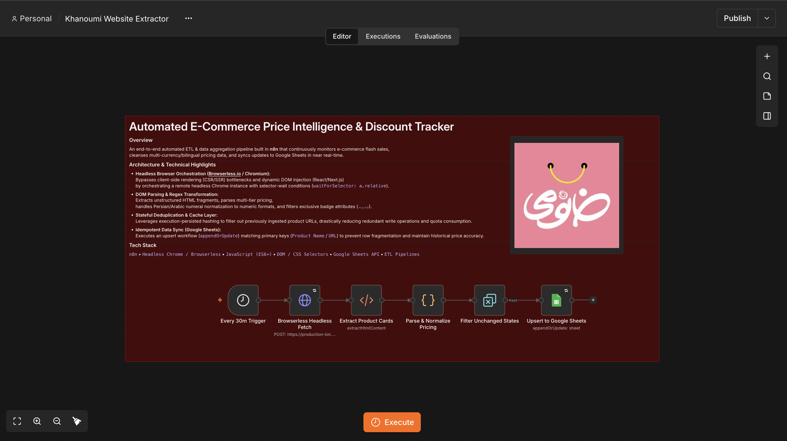

# 🛍️ Automated E-Commerce Price Intelligence & Discount Tracker

An end-to-end automated ETL & data aggregation pipeline built in **n8n** that continuously monitors e-commerce flash sales, cleanses multi-currency/bilingual pricing data, and syncs updates to Google Sheets in near real-time.

---

### ⚙️ Architecture & Technical Highlights
* **Headless Browser Orchestration (Browserless.io / Chromium):** Bypasses client-side rendering (CSR/SSR) bottlenecks and dynamic DOM injection (React/Next.js) by orchestrating a remote headless Chrome instance with selector-wait conditions.
* **DOM Parsing & Regex Transformation:** Extracts unstructured HTML fragments, parses multi-tier pricing, handles Persian/Arabic numeral normalization to numeric formats, and filters exclusive badge attributes (`جدید`).
* **Stateful Deduplication & Composite Keys:** Leverages custom JavaScript logic to generate unique state hashes (`URL + Price After`), ensuring efficient API usage while instantly triggering updates when prices drop.
* **Idempotent Data Sync (Google Sheets):** Executes an upsert workflow matching primary keys (`URL`) to prevent row fragmentation and maintain historical price accuracy.

---

### 🛠️ Tech Stack & Tools
* **Workflow Engine:** `n8n` (Self-Hosted via Docker)
* **Web Scraping:** Browserless / Headless Chrome
* **Data Processing:** JavaScript (ES6+, Regex, DOM Selectors)
* **Storage / Sink:** Google Sheets API (Upsert Operations)