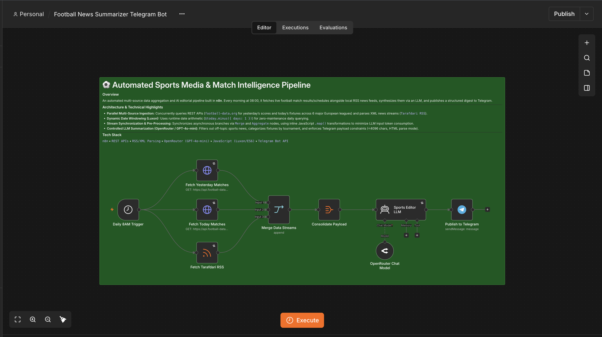

# ⚽ Automated Sports Media & Match Intelligence Pipeline

An automated multi-source data aggregation and AI editorial pipeline built in **n8n**. Every morning, it fetches live football match results/schedules alongside local RSS news feeds, synthesizes them via an LLM, and publishes a structured digest to Telegram.

---

### 📡 Architecture & Technical Highlights
* **Parallel Multi-Source Ingestion:** Concurrently queries REST APIs (`football-data.org` for yesterday's scores and today's fixtures across 6 major European leagues) and parses XML news streams (`Tarafdari RSS`).
* **Dynamic Date Windowing (Luxon):** Uses runtime date arithmetic (`$today.minus({ days: 1 })`) for zero-maintenance daily querying.
* **Stream Synchronization & Pre-Processing:** Synchronizes asynchronous branches via `Merge` and `Aggregate` nodes, using inline JavaScript `.map()` transformations to minimize LLM input token consumption.
* **Controlled LLM Summarization (OpenRouter / GPT-4o-mini):** Filters out off-topic sports news, categorizes fixtures by tournament, and enforces Telegram payload constraints (<4096 chars, HTML parse mode).

---

### 🛠️ Tech Stack & Tools
* **Workflow Engine:** `n8n` (Self-Hosted via Docker)
* **APIs & Feeds:** Football-Data REST API, Tarafdari RSS/XML
* **AI Model:** OpenRouter (`GPT-4o-mini`)
* **Messaging Delivery:** Telegram Bot API (HTML Formatting)