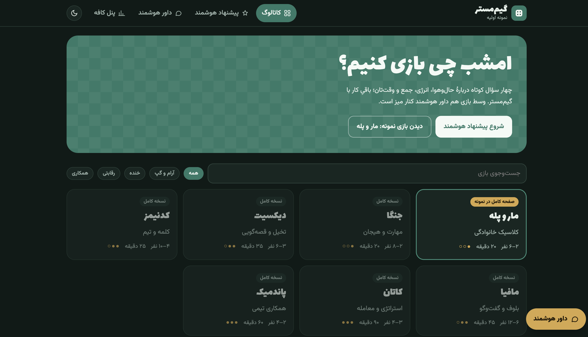
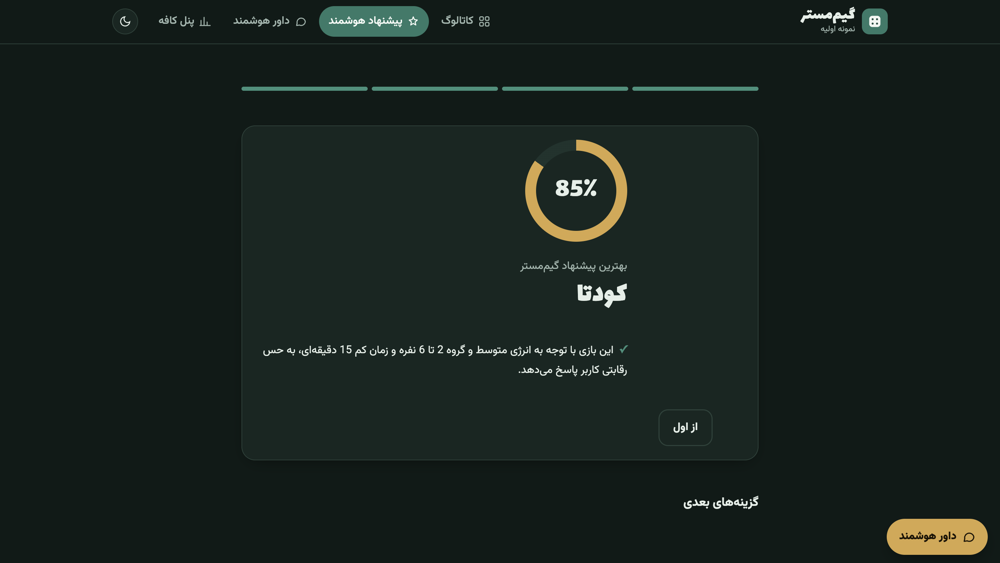
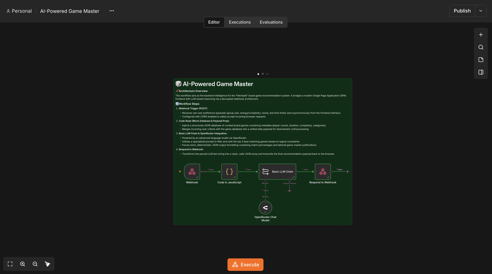

# 🎲 AI-Powered Board Game Recommender & Game Master

A full-stack, AI-driven recommendation system designed for board game cafes. This project bridges a modern Single Page Application (SPA) frontend with an automated backend built on **n8n**, utilizing advanced LLMs via **OpenRouter** to provide intelligent, contextual game suggestions.

---

## 📸 Preview

### 🎨 Frontend Interface (SPA)

  

  

### ⚙️ n8n Automation Workflow

  

---

## 🏗️ Architecture & Tech Stack
* **Frontend:** HTML5, CSS3 (Modern Grid/Flexbox, Custom Dark/Light Themes), JavaScript (SPA, Fetch API).
* **Workflow Automation & Logic:** n8n (Self-Hosted).
* **Artificial Intelligence:** LLM Integration (Google Gemini / GPT-4o-mini via OpenRouter) with strict JSON output formatting.
* **Infrastructure:** Docker & Docker Compose (PostgreSQL backend for n8n).

---

## 🔄 How It Works
1. **User Interaction:** Users complete an interactive preference questionnaire on the frontend (specifying group size, energy/complexity, mood, and time limits).
2. **Webhook Trigger:** The frontend asynchronously sends the payload via a `POST` request to an **n8n Webhook**.
3. **Data Merging:** A Code Node injects a curated board game database and merges it with the user's preferences.
4. **LLM Reasoning:** The Basic LLM Chain evaluates constraints, calculates match percentages, and generates tailored justifications.
5. **Response Delivery:** The data is transformed back into a clean JSON array and rendered dynamically on the user interface.

---

## 🚀 Setup

1. Import `n8n-workflow/AI-Powered Game Master.json` into n8n and attach an OpenRouter credential.
2. Activate the workflow. The endpoint is `POST http://localhost:5678/webhook/game-master`.
3. Open `frontend/index.html` in a browser. If your n8n runs elsewhere, edit `n8nWebhookUrl` in the `renderResult` function.

## ⚠️ Known limitations

- The webhook has no authentication; set a spending limit on your OpenRouter key.
- The game catalog is a static list inside the "Code in JavaScript" node.
